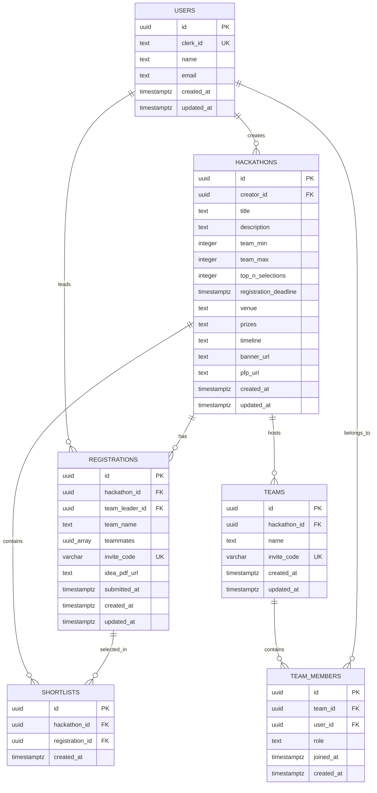
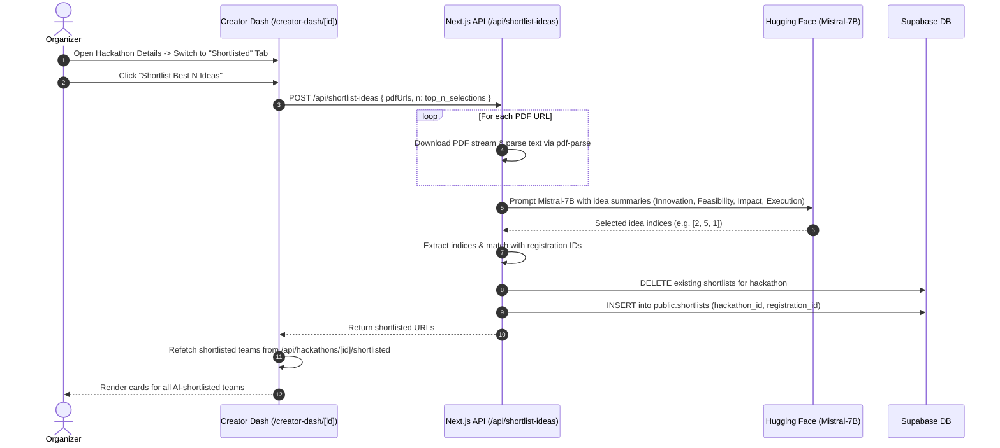
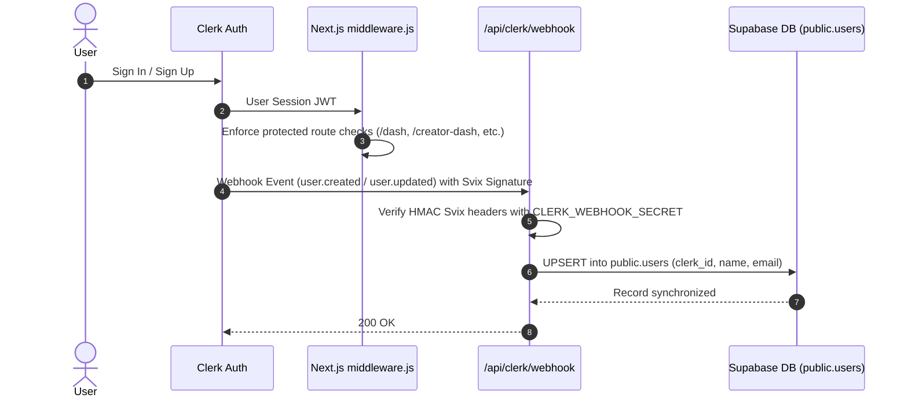

# HackNect — Comprehensive Project Context & Technical Architecture

---

## 1. Executive Summary & Problem Statement

### 1.1 Overview
**HackNect** is a comprehensive, next-generation hackathon management and team collaboration platform designed for modern tech communities, educational institutions, student innovators, and hackathon organizers. It bridges the gap between organizers hosting large-scale events and participants looking to discover hackathons, assemble teams, and submit project proposals.

### 1.2 Problem Statement
Traditional hackathon management platforms suffer from significant operational bottlenecks:
1. **Manual Idea Screening Overhead**: In large hackathons with hundreds or thousands of registrants, organizers spend countless manual hours reading multi-page project proposal PDFs during round-1 evaluations, leading to delays and subjective fatigue.
2. **Friction in Team Formation**: Coordinating team invites, enforcing minimum and maximum team member constraints, and managing registration codes often requires clunky external spreadsheets or fragmented communication channels.
3. **Fragmented Creator & Participant Experience**: Lack of unified, real-time dashboards to track team status, submission readiness, countdown deadlines, and shortlisting results in confusion and dropped registrations.

### 1.3 The HackNect Solution
HackNect provides an integrated, full-stack solution featuring:
- **AI-Powered Round-1 Shortlisting**: Leverages natural language processing and Large Language Models (LLMs) to automatically parse PDF submissions, extract core project ideas, evaluate them against standardized judging criteria (innovation, feasibility, impact, technical execution), and select the top-$N$ teams in seconds.
- **Frictionless Team Assembling**: Instant 8-character unique invite code generation allowing team leads to create teams and invite peers with automatic member limit enforcement (min/max size validation).
- **Dual-Sided Unified Portals**: Distinct yet harmonious interfaces for participants (registration tracking, wins counter, idea PDF upload workspace) and creators (event metrics, applicant roster, live editing, AI shortlisting triggers).

---

## 2. Core Features & Use Cases

### 2.1 Participant Experience
- **Hackathon Discovery (`/explore`)**: Filter hackathons by event type (Virtual vs. Offline), Indian cities, and timeline urgency (This Week, This Month, This Year).
- **Hackathon Deep-Dive (`/explore/[id]`)**: Comprehensive event overview including countdown timers, registration status badges, team size guidelines, prizes, timeline, and venue info.
- **Team Creation & Joining (`/explore/[id]/register`)**:
  - *Create Team*: Auto-generates an alphanumeric invite code, assigns leader permissions, and links the registration to the target hackathon.
  - *Join Team*: Fast entry via an invite code with automated validation against duplicate registrations and team size caps.
- **Participant Dashboard (`/dash`)**:
  - Centralized metrics: *Created Hackathons*, *Participating Events*, *Completed Events*, and *AI Shortlisted Wins*.
  - Color-coded registration cards indicating idea submission status and deadline expiration.
- **Team Workspace (`/registration/[id]`)**:
  - View leader and teammate rosters.
  - One-click invite code copying.
  - Team-size gatekeeping for proposal submission: strictly requires meeting minimum team size before the team leader can upload the project proposal PDF.
  - Direct PDF preview link once uploaded to Supabase Storage.

### 2.2 Organizer / Creator Experience
- **Hackathon Creation (`/hosting`)**: Form to publish new hackathons with custom banner/avatar uploads, offline city selection (from comprehensive list of Indian cities) or virtual mode, minimum/maximum team sizes, top-$N$ winners quota, prizes, timeline, and registration deadlines.
- **Creator Dashboard (`/creator-dash`)**: List of all hosted hackathons with live registration badges (*Open with days left* vs. *Expired*), quick-access view/edit actions, and total event counters.
- **Event Control Center (`/creator-dash/[id]`)**:
  - **Details Tab**: Live in-place editing of title, description, team size bounds, deadlines, venue, prizes, timeline, and banner/avatar assets.
  - **Registrations Tab**: Analytics cards (Total Teams, Total Participants, Average Team Size, Latest Registration) and complete registrant roster with team member cards and direct PDF inspection links.
  - **Shortlisted Tab**: Trigger the **AI First-Round Shortlisting Engine** for the top-$N$ selections, view automated ranking results, and inspect shortlisted teams.

---

## 3. Technology Stack & Architecture

```
                                  +-----------------------+
                                  |    Clerk Auth SaaS    |
                                  +-----------+-----------+
                                              | Webhooks (Svix)
                                              v
+------------------------+        +-----------------------+        +------------------------+
|      Client / UI       |<------>|  Next.js 15 App Router|<------>|     Supabase PG DB     |
|  (React 19, Tailwind)  |        |    (Server Actions &  |        |  (PostgreSQL + Storage)|
+------------------------+        |     Route Handlers)   |        +------------------------+
                                  +-----------+-----------+
                                              |
                                              | PDF Buffer Stream & Prompt
                                              v
                                  +-----------------------+
                                  | Hugging Face Inference|
                                  | (Mistral-7B-Instruct) |
                                  +-----------------------+
```

| Layer | Technology | Description |
| :--- | :--- | :--- |
| **Frontend Framework** | **Next.js 15.3.5 (App Router)** | Hybrid client and server components, server-side data handling, Turbopack support. |
| **UI Library** | **React 19** | Modern React primitives, hooks, state management. |
| **Styling & Icons** | **TailwindCSS v4**, **Lucide React** | Sleek glassmorphism aesthetic, custom gradient text, dark theme, responsive grid layouts. |
| **Authentication** | **Clerk (`@clerk/nextjs` v6)** | Authentication, session token management, user profile modal, server-side route matcher. |
| **Webhook Security** | **Svix v1.69.0** | Cryptographic HMAC signature verification of incoming Clerk lifecycle webhooks. |
| **Database** | **Supabase (PostgreSQL)** | Relational database with Foreign Keys, Cascades, GIN Indexes, Triggers, and RLS. |
| **File Storage** | **Supabase Storage** | Public buckets: `hackathons` (banners/pfps) and `registrations` (idea proposal PDFs). |
| **Document Processing** | **`pdf-parse` (v1.1.1)** | Server-side binary PDF parsing and text buffer extraction. |
| **AI Inference** | **Hugging Face Inference API (`@huggingface/inference`)** | Model: `mistralai/Mistral-7B-Instruct-v0.3` for automated multi-document evaluation and ranking. |

---

## 4. Database Architecture & Schema

The database is built on PostgreSQL hosted via Supabase. All tables enforce strict foreign key constraints, cascading deletions, and automatic `updated_at` triggers.



### 4.1 Schema Specifications

#### 1. `public.users`
Stores user profile records synchronized directly from Clerk via Svix-verified webhooks.
- `id` (`UUID`, Primary Key, default `gen_random_uuid()`)
- `clerk_id` (`TEXT`, UNIQUE, Indexed) — Clerk external user identifier.
- `name` (`TEXT`) — Combined first and last name or username.
- `email` (`TEXT`, Indexed) — Primary email address.
- `created_at` / `updated_at` (`TIMESTAMPTZ`)

#### 2. `public.hackathons`
Stores all hackathon events published by creators.
- `id` (`UUID`, Primary Key)
- `creator_id` (`UUID`, Foreign Key -> `users.id` ON DELETE CASCADE)
- `title` (`TEXT`, NOT NULL)
- `description` (`TEXT`)
- `team_min` (`INTEGER`, Default 1)
- `team_max` (`INTEGER`, Default 4)
- `top_n_selections` (`INTEGER`) — Target quota for AI first-round selections.
- `registration_deadline` (`TIMESTAMPTZ`)
- `venue` (`TEXT`) — `"Virtual Event"` or `"<Detailed Venue>, <City>, India"`.
- `prizes` (`TEXT`), `timeline` (`TEXT`)
- `banner_url` (`TEXT`), `pfp_url` (`TEXT`)
- `created_at` / `updated_at` (`TIMESTAMPTZ`)

#### 3. `public.registrations`
Tracks team registrations for each hackathon.
- `id` (`UUID`, Primary Key)
- `hackathon_id` (`UUID`, Foreign Key -> `hackathons.id` ON DELETE CASCADE)
- `team_leader_id` (`UUID`, Foreign Key -> `users.id` ON DELETE CASCADE)
- `team_name` (`TEXT`, NOT NULL)
- `teammates` (`UUID[]`, Default `{}`) — Indexed with PostgreSQL **GIN** index (`idx_registrations_teammates_gin`) for high-performance array containment lookups (`teammates.cs.{userId}`).
- `invite_code` (`VARCHAR(10)`, UNIQUE, Indexed) — 8-character random alphanumeric code.
- `idea_pdf_url` (`TEXT`, Indexed) — Public URL to the uploaded proposal PDF in Supabase Storage.
- `submitted_at` / `created_at` / `updated_at` (`TIMESTAMPTZ`)

#### 4. `public.shortlists`
Stores the output of the AI shortlisting algorithm.
- `id` (`UUID`, Primary Key)
- `hackathon_id` (`UUID`, Foreign Key -> `hackathons.id` ON DELETE CASCADE)
- `registration_id` (`UUID`, Foreign Key -> `registrations.id` ON DELETE CASCADE)
- `created_at` (`TIMESTAMPTZ`)
- **Constraint**: `UNIQUE (hackathon_id, registration_id)` ensures idempotent shortlist insertion.

#### 5. `public.teams` & `public.team_members`
Normalized relational structure for extended team rosters and granular roles (`leader`, `member`).

### 4.2 Storage Buckets
- `hackathons`: Stores event banner and profile picture images under `/banners/` and `/pfps/`.
- `registrations`: Stores team project proposal PDFs under `/pdfs/`.

---

## 5. API Endpoints & Request / Response Specifications

All internal APIs reside in `app/api/**` and use standard Next.js Route Handlers (`Response` / `NextResponse`).

### 5.1 Authentication & User Webhooks

#### `POST /api/clerk/webhook` & `/api/webhook/register`
- **Purpose**: Listens to Clerk user events to synchronize user data into Supabase `public.users`.
- **Security**: Validates `svix-id`, `svix-timestamp`, and `svix-signature` using `CLERK_WEBHOOK_SECRET`.
- **Handled Events**:
  - `user.created` / `user.updated`: Upserts `{ clerk_id, name, email }` on conflict `clerk_id`.
  - `user.deleted`: Deletes record matching `clerk_id`.
- **Response**: `200 User saved` | `400 Invalid signature` | `500 Server misconfigured`

---

### 5.2 Hackathons Endpoints

#### `GET /api/hackathons`
- **Auth**: Requires Clerk session.
- **Description**: Returns all hackathons created by the authenticated user (`creator_id`).
- **Response**:
```json
{
  "success": true,
  "data": [
    {
      "id": "uuid",
      "creator_id": "uuid",
      "title": "AI Nexus Hackathon",
      "description": "...",
      "team_min": 2,
      "team_max": 4,
      "top_n_selections": 5,
      "registration_deadline": "2026-09-30T18:30:00Z",
      "venue": "Tech Park, Bangalore, India",
      "banner_url": "https://...",
      "pfp_url": "https://..."
    }
  ]
}
```

#### `POST /api/hackathons`
- **Auth**: Requires Clerk session.
- **Content-Type**: `multipart/form-data`
- **Payload**: `title`, `description`, `team_min`, `team_max`, `top_n_selections`, `registration_deadline`, `venue`, `prizes`, `timeline`, `banner_url` (File), `pfp_url` (File).
- **Processing**: Uploads files to Supabase `hackathons` bucket, then inserts metadata into `public.hackathons` linked to authenticated `users.id`.
- **Response**: `201 Created`

#### `GET /api/hackathons/[id]`
- **Auth**: Requires Clerk session.
- **Description**: Fetches a single hackathon and checks whether the authenticated user is the creator (`isCreator`).

#### `PUT /api/hackathons/[id]`
- **Auth**: Requires Clerk session (must match `creator_id`).
- **Content-Type**: `multipart/form-data`
- **Description**: Updates hackathon metadata and optionally replaces banner/pfp assets in storage.

#### `GET /api/hackathons/public`
- **Auth**: Public access.
- **Description**: Returns all hackathons ordered by `created_at DESC` with joined registration counts (`teamsCount` / `teams_count`).

#### `GET /api/hackathons/public/[id]`
- **Auth**: Public access.
- **Description**: Returns full public details of a specific hackathon, including creator info and registered team count.

#### `GET /api/hackathons/[id]/registrations`
- **Auth**: Requires creator session for `[id]`.
- **Description**: Retrieves all teams registered for the hackathon, including team leader profile and all teammates' profile details (`id, name, email`).

#### `GET /api/hackathons/[id]/shortlisted`
- **Auth**: Requires creator session for `[id]`.
- **Description**: Fetches detailed team information for registrations present in `public.shortlists` for that hackathon.

---

### 5.3 Teams & Registrations Endpoints

#### `GET /api/teams`
- **Auth**: Requires Clerk session.
- **Description**: Retrieves all registrations where the user is either the `team_leader_id` or present in the `teammates` UUID array.
- **Query Filter**: `.or('team_leader_id.eq.${userData.id},teammates.cs.{${userData.id}}')`

#### `POST /api/teams`
- **Auth**: Requires Clerk session.
- **Payload**:
  - **Create Action**:
    ```json
    { "action": "create", "teamName": "ByteBusters", "hackathonId": "uuid" }
    ```
    *Validation*: Checks user isn't already registered for this hackathon; generates unique 8-char invite code; inserts registration with leader as first teammate.
  - **Join Action**:
    ```json
    { "action": "join", "inviteCode": "A1B2C3D4" }
    ```
    *Validation*: Checks code validity, verifies user is not already registered in this or another team for the same hackathon, enforces `team_max` limit, appends `user.id` to `teammates` array.

#### `GET /api/registrations/[id]`
- **Auth**: Requires Clerk session (user must be team leader or teammate in this registration).
- **Description**: Returns registration record, associated hackathon details, full teammate objects, and flags (`isTeamLeader`, `currentUserId`).

#### `PUT /api/registrations/[id]`
- **Auth**: Requires Clerk session (must be `team_leader_id`).
- **Content-Type**: `multipart/form-data` (`pdf` File).
- **Validation**:
  - Verifies current member count $\ge$ `hackathons.team_min`.
  - Verifies file type is `application/pdf`.
- **Processing**: Uploads PDF to Supabase `registrations` bucket under `pdfs/${id}_${Date.now()}.pdf`, updates `idea_pdf_url` on `public.registrations`.
- **Response**: `200 { "success": true, "url": "https://..." }`

---

### 5.4 AI Shortlisting & Scoring Endpoints

#### `POST /api/shortlist-ideas`
- **Payload**:
  ```json
  {
    "pdfUrls": ["https://.../pdf1.pdf", "https://.../pdf2.pdf"],
    "n": 3
  }
  ```
- **Execution Pipeline**:
  1. **Validation**: Ensures valid URL format and limits array size ($\le 20$).
  2. **PDF Text Extraction**: Fetches each PDF using `fetch()` and parses content with `pdfParse(buffer)`.
  3. **Content Filtering**: Discards empty or unreadable PDFs ($< 10$ characters).
  4. **LLM Evaluation**: Constructs a structured prompt containing the first 2,000 characters of each idea and invokes Hugging Face `mistralai/Mistral-7B-Instruct-v0.3`.
  5. **Fallback Strategy**:
     - Attempt 1: `client.chatCompletion(...)`
     - Attempt 2: `client.textGeneration(...)`
     - Attempt 3: Deterministic fallback to initial $N$ valid submissions if AI API is unreachable.
  6. **Regex & Index Parsing**: Extracts JSON array `[1, 3, 2]` from LLM response and maps to the corresponding PDF URLs.
  7. **Persistence**: Deletes old shortlists for the hackathon and inserts new rows into `public.shortlists`.
- **Response**:
  ```json
  {
    "success": true,
    "shortlisted": ["https://.../pdf1.pdf", "https://.../pdf3.pdf"]
  }
  ```

#### `POST /api/shortlists/user-wins`
- **Payload**: `{ "registrationIds": ["uuid1", "uuid2", ...] }`
- **Description**: Returns exact count of user registrations that have been shortlisted (`count`).

---

## 6. End-to-End Workflows

### 6.1 Participant Registration & Submission Flow

```mermaid
sequenceDiagram
    autonumber
    actor Participant
    participant UI as HackNect Frontend (/explore)
    participant API as Next.js API (/api/teams)
    participant Supabase as Supabase DB & Storage
    
    Participant->>UI: Browse & Select Hackathon
    Participant->>UI: Click "Register" -> Choose "Create Team" or "Join Team"
    alt Create Team
        Participant->>API: POST /api/teams { action: 'create', teamName, hackathonId }
        API->>Supabase: Check existing registration for user & hackathon
        API->>Supabase: Insert into registrations (with generated invite_code)
        API-->>UI: Return registration & inviteCode
        UI-->>Participant: Display invite code to share with teammates
    else Join Team
        Participant->>API: POST /api/teams { action: 'join', inviteCode }
        API->>Supabase: Verify code & team_max capacity
        API->>Supabase: Append user_id to teammates array
        API-->>UI: Return success confirmation
    end

    Participant->>UI: Navigate to Team Workspace (/registration/[id])
    Note over Participant, UI: Teammates join via invite code until min_team size met
    Participant->>UI: Team Leader uploads Project Proposal PDF
    UI->>API: PUT /api/registrations/[id] (FormData with PDF)
    API->>Supabase: Validate team_min, upload to bucket 'registrations'
    API->>Supabase: Update registrations.idea_pdf_url
    API-->>UI: Return PDF URL & update UI to "Idea PDF Submitted"
```

---

### 6.2 Organizer AI Shortlisting Flow



---

### 6.3 Authentication & User Sync Flow



---

## 7. Project Structure & Codebase Map

```
HackNect/
├── .clerk/                        # Clerk temporary local dev configurations
├── app/                           # Next.js 15 App Router
│   ├── api/                       # Backend API route handlers
│   │   ├── clerk/
│   │   │   └── webhook/route.js   # Svix-verified Clerk webhook handler
│   │   ├── hackathons/
│   │   │   ├── route.js           # GET (user created), POST (create hackathon)
│   │   │   ├── [id]/
│   │   │   │   ├── route.js       # GET / PUT specific hackathon
│   │   │   │   ├── registrations/ # GET all registrations for a hackathon
│   │   │   │   └── shortlisted/   # GET all shortlisted teams for a hackathon
│   │   │   └── public/
│   │   │       ├── route.js       # GET all hackathons for public explore
│   │   │       └── [id]/route.js  # GET public hackathon details
│   │   ├── registrations/
│   │   │   └── [id]/route.js      # GET details / PUT upload PDF
│   │   ├── shortlist-ideas/
│   │   │   └── route.js           # AI PDF parser & Hugging Face judging engine
│   │   ├── shortlists/
│   │   │   └── user-wins/route.js # POST count shortlisted wins for user
│   │   ├── teams/
│   │   │   ├── route.js           # GET user teams, POST create/join team
│   │   │   └── [id]/
│   │   │       └── members/route.js # GET team members by team ID
│   │   └── webhook/
│   │       └── register/route.js  # Re-exports Clerk webhook
│   ├── creator-dash/              # Creator Portal
│   │   ├── page.jsx               # Creator Dashboard (list of hosted events)
│   │   └── [id]/page.jsx          # Event Management: Details, Registrations, AI Shortlisting
│   ├── dash/
│   │   └── page.jsx               # Participant Dashboard (metrics, registrations, status)
│   ├── explore/                   # Public Exploration
│   │   ├── page.jsx               # Filterable hackathons directory
│   │   └── [id]/
│   │       ├── page.jsx           # Hackathon overview & countdown
│   │       └── register/page.jsx  # Team creation & invite-code joining
│   ├── hosting/
│   │   └── page.jsx               # Host a Hackathon form (offline/virtual, banners, constraints)
│   ├── registration/
│   │   └── [id]/page.jsx          # Team submission workspace (PDF upload, invite sharing)
│   ├── teams/
│   │   └── [id]/page.jsx          # Team member roster view
│   ├── globals.css                # Global styles & Tailwind imports
│   ├── layout.js                  # Root layout (ClerkProvider, Background, Navbar)
│   └── page.jsx                   # Landing Page (Featured hackathons, Why HackNect)
├── components/                    # Reusable React UI Components
│   ├── Background.jsx             # Ambient canvas/particle backdrop
│   ├── Loader.jsx                 # Custom animated spinner
│   └── Navbar.jsx                 # Dynamic responsive navbar with Clerk user menu
├── lib/
│   └── supabase.js                # Singleton Supabase client (Service Role for API)
├── public/                        # Static assets (icons, default banners)
├── supabase/                      # Database configuration & migrations
│   ├── migrations/
│   │   └── 20260815190743_create_users.sql
│   └── config.toml
├── middleware.js                  # Clerk route protection middleware
├── supabase_schema.sql            # Master database setup script (Tables, RLS, Storage, Triggers)
├── package.json                   # Dependencies & scripts
└── context.md                     # Comprehensive project documentation
```

---

## 8. Security & Business Rules

### 8.1 Route Protection & Authentication
- Protected routes in `middleware.js`:
  - `/dash(.*)`
  - `/creator-dash(.*)`
  - `/explore/:id/register(.*)`
  - `/teams(.*)`
  - `/registrations(.*)`
  - `/hosting(.*)`
- Unauthenticated visitors accessing protected routes are automatically redirected to Clerk sign-in.

### 8.2 Team Size & Submission Constraints
1. **Minimum Team Size Enforcement**: Teams cannot submit an idea PDF until the total unique members (Leader + Teammates) meets or exceeds `hackathons.team_min`. The UI locks the upload form with explanatory warnings, and the API rejects undersized submissions with `400 Bad Request`.
2. **Maximum Team Size Enforcement**: Joining via invite code verifies that current team size does not exceed `hackathons.team_max`.
3. **Single Registration Rule**: A user cannot register more than once for the same hackathon (neither as leader nor teammate).

### 8.3 Creator Authorization
- Only the user whose `users.id` matches `hackathons.creator_id` can:
  - Edit hackathon details (`PUT /api/hackathons/[id]`).
  - Access registrant email rosters (`GET /api/hackathons/[id]/registrations`).
  - Trigger AI shortlisting runs.

---

## 9. Environment Variables Configuration

| Variable Name | Purpose | Example / Notes |
| :--- | :--- | :--- |
| `NEXT_PUBLIC_CLERK_PUBLISHABLE_KEY` | Clerk client authentication | `pk_test_...` |
| `CLERK_SECRET_KEY` | Clerk server authentication | `sk_test_...` |
| `CLERK_WEBHOOK_SECRET` | Svix HMAC secret for Clerk webhook verification | `whsec_...` |
| `SUPABASE_URL` | Supabase project URL | `https://<ref>.supabase.co` |
| `SUPABASE_SERVICE_ROLE_KEY` | Supabase admin key for server-side queries & storage operations | `sb_secret_...` |
| `HUGGING_FACE_KEY` / `HF_TOKEN` | Hugging Face API key for LLM shortlisting | `hf_...` |

---

## 10. Development & Deployment Guide

### 10.1 Local Development
```bash
# 1. Install dependencies
npm install

# 2. Configure Environment Variables
# Create a .env file with the variables listed in Section 9

# 3. Apply Supabase Database Schema
# Copy and execute supabase_schema.sql in your Supabase SQL Editor

# 4. Start Next.js Development Server (with Turbopack)
npm run dev
```

### 10.2 Production Build
```bash
# Build optimized Next.js bundle
npm run build

# Start production server
npm run start
```
