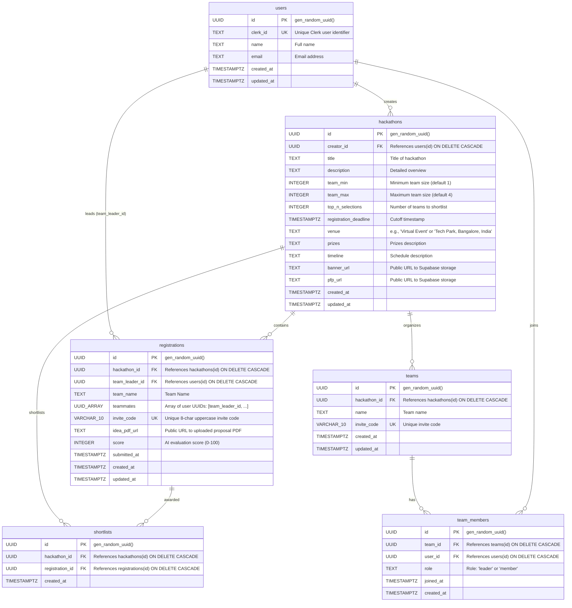

# HackNect — Comprehensive Codebase & Architecture Context

> **Target Audience**: AI coding agents, developers, and maintainers.  
> **Document Purpose**: Single source of truth detailing the architecture, database schema, APIs, security, workflows, algorithms, and deployment instructions for HackNect.

---

## Table of Contents
1. [Project Overview](#1-project-overview)
2. [Tech Stack & Dependencies](#2-tech-stack--dependencies)
3. [Architecture & Project Structure](#3-architecture--project-structure)
4. [Database Schema & Data Models](#4-database-schema--data-models)
5. [End-to-End Workflows & User Journeys](#5-end-to-end-workflows--user-journeys)
6. [Complete API Reference](#6-complete-api-reference)
7. [Authentication, Authorization & Security](#7-authentication-authorization--security)
8. [Core Business Logic & Algorithms](#8-core-business-logic--algorithms)
9. [Setup, Configuration & Deployment](#9-setup-configuration--deployment)
10. [Architectural Nuances, Discrepancies & Recommendations](#10-architectural-nuances-discrepancies--recommendations)

---

## 1. Project Overview

### 1.1 Purpose & Mission
**HackNect** is a full-stack web application designed to streamline hackathon discovery, team formation, hackathon administration, and submission evaluation. It is specifically tailored for hackathons in India and global developer communities, bridging the gap between hackathon organizers and student/developer participants.

### 1.2 Problems Solved
1. **Organizer Overhead & Bottlenecks**: Organizing hackathons traditionally involves managing team spreadsheets, tracking PDF idea submissions, and manually grading hundreds of proposals in round 1.
2. **Team Formation Friction**: Solo participants struggle to team up with friends or find teammates with a transparent invite mechanism and enforced team capacity limits.
3. **Subjective & Slow First-Round Judging**: Evaluating initial pitch decks or project idea documents is often subjective, biased, and slow. HackNect automates initial shortlisting using Google Gemini AI, applying a strict 100-point standardized rubric across Innovation, Social Impact, Feasibility, and Technical Execution.
4. **Participant Tracking**: Participants lack a unified portal to track their registrations, ongoing competitions, submission status, and shortlisted wins.

### 1.3 Key Features
- **Public Hackathon Discovery ([`ExplorePage`](file:///c:/Users/yatis/Desktop/HackNect/HackNect/app/explore/page.jsx))**:
  - Filter hackathons by Event Type (`Virtual` vs `Offline`).
  - Filter by 150+ major Indian cities (e.g., Bangalore, Mumbai, Delhi, Hyderabad, Pune).
  - Filter by Registration Deadline (`This Week`, `This Month`, `This Year`).
  - Auto-hides expired hackathons from active discovery.
- **Hackathon Hosting & Administration ([`HackathonForm`](file:///c:/Users/yatis/Desktop/HackNect/HackNect/app/hosting/page.jsx))**:
  - Organizers define titles, descriptions, timelines, prize pools, registration deadlines, and team size limits (`team_min`, `team_max`).
  - Support for virtual event tagging or structured offline venues (`detailed_venue`, `city`, `India`).
  - Media uploads: Banner images and profile avatars uploaded directly to Supabase Storage.
  - Creator dashboard ([`CreatorDash`](file:///c:/Users/yatis/Desktop/HackNect/HackNect/app/creator-dash/page.jsx)) with live analytics, participant counts, and in-place event editing.
- **Team Management & Invite Code System ([`HackathonTeamRegistration`](file:///c:/Users/yatis/Desktop/HackNect/HackNect/app/explore/[id]/register/page.jsx))**:
  - Team leaders create a team and automatically receive a unique 8-character alphanumeric invite code (e.g., `AB12CD34`).
  - Teammates enter the invite code to instantly join the team.
  - Automatic validation prevents double-registration for the same hackathon and enforces `team_max`.
- **Idea PDF Submission Gate ([`RegistrationDetailPage`](file:///c:/Users/yatis/Desktop/HackNect/HackNect/app/registration/[id]/page.jsx))**:
  - Locks submission until the team meets the required `team_min` threshold.
  - Restricts uploading to the designated team leader.
  - Uploads idea documents (pitch decks, architecture diagrams) to Supabase Storage and records the public URL.
- **AI-Powered First Round Shortlisting ([`POST /api/shortlist-ideas`](file:///c:/Users/yatis/Desktop/HackNect/HackNect/app/api/shortlist-ideas/route.js))**:
  - One-click trigger for organizers from the creator dashboard.
  - Automatically fetches all submitted idea PDFs for the hackathon.
  - Extracts text via [`extractPdfTexts`](file:///c:/Users/yatis/Desktop/HackNect/HackNect/app/api/shortlist-ideas/components/pdfParser.js).
  - Evaluates each proposal with Google Gemini (`gemini-3.5-flash-lite`) using a standardized rubric.
  - Persists individual scores (0–100) to the registrations table and writes top-$N$ winners into the `shortlists` table.
- **Participant Dashboard ([`page`](file:///c:/Users/yatis/Desktop/HackNect/HackNect/app/dash/page.jsx))**:
  - Real-time statistics: Total Created, Ongoing Participating, Completed, and Shortlisted Wins.
  - Color-coded submission badges: Idea PDF Uploaded vs Missing, Ongoing vs Expired.

---

## 2. Tech Stack & Dependencies

All dependencies are sourced directly from [package.json](file:///c:/Users/yatis/Desktop/HackNect/HackNect/package.json):

| Category | Technology / Library | Version | Role in HackNect |
| :--- | :--- | :--- | :--- |
| **Framework** | Next.js | `^16.4.0` | React full-stack framework utilizing App Router (`app/` directory), Turbopack dev server, and route handlers. |
| **UI Library** | React & React DOM | `^19.0.0` | Core declarative component rendering engine. |
| **Authentication** | `@clerk/nextjs` | `^7.9.15` | User authentication, session management, route protection, `<ClerkProvider />`, `<SignInButton />`, `<UserButton />`. |
| **Webhook Verification** | `svix` | `^1.69.0` | Cryptographic signature verification for incoming Clerk user webhooks (`user.created`, `user.updated`, `user.deleted`). |
| **Database & Storage** | `@supabase/supabase-js` | `^2.50.5` | PostgreSQL client & object storage SDK used in server-side API routes via service role key. |
| **LLM & AI Evaluation** | `@google/genai` | `^2.29.0` | Official Google GenAI SDK used to evaluate submitted proposal PDFs using Gemini (`gemini-3.5-flash-lite`). |
| **PDF Extraction** | `pdf-parse` | `^1.1.1` | Server-side buffer-based text extraction from downloaded submission PDFs. |
| **Styling** | Tailwind CSS & `@tailwindcss/postcss` | `^4.0.0` | Utility-first CSS styling using Tailwind v4 `@import "tailwindcss";`. |
| **Icons** | `lucide-react` | `^0.525.0` | UI icon set (Users, Trophy, Plus, MapPin, Calendar, Clock, Crown, etc.). |
| **Identifiers** | `uuid` | `^11.1.0` | Unique UUIDv4 generation for storage file paths (`banners/`, `pfps/`). |
| **HTTP Fetch** | `node-fetch` | `^3.3.2` | Server-side HTTP request utility for remote asset fetching. |
| **Utilities** | `formidable`, `micro`, `@huggingface/inference` | Various | Form parsing and helper dependencies declared in `package.json`. |

---

## 3. Architecture & Project Structure

HackNect follows the Next.js App Router architecture. The root layout provides global auth context via Clerk and renders an ambient animated background alongside the responsive navigation bar.

### 3.1 Directory Tree

```
HackNect/
├── .env                              # Environment variables (Clerk, Supabase, Gemini)
├── .gitignore                        # Git ignore patterns
├── README.md                         # Standard Next.js setup readme
├── TEAM_SETUP.md                     # Documentation placeholder
├── eslint.config.mjs                 # ESLint flat config
├── jsconfig.json                     # Path aliases: "@/*" -> "./*"
├── middleware.js                     # Clerk route protection middleware
├── next.config.mjs                   # Next.js build configuration
├── package.json                      # Project dependencies and npm scripts
├── postcss.config.mjs                # PostCSS plugins config (Tailwind v4)
├── supabase_schema.sql               # Complete SQL schema, RLS, indexes, triggers & storage setup
│
├── app/                              # Next.js App Router root
│   ├── favicon.ico                   # App icon
│   ├── globals.css                   # Global CSS, Tailwind v4 import & custom styles
│   ├── layout.js                     # Root layout with ClerkProvider, Background & Navbar
│   ├── page.jsx                      # Landing page featuring top hackathons & value props
│   │
│   ├── api/                          # Server-side API Route Handlers
│   │   ├── clerk/webhook/route.js    # Clerk webhook receiver (syncs users to Supabase)
│   │   ├── hackathons/
│   │   │   ├── route.js              # GET user created hackathons, POST create hackathon
│   │   │   ├── [id]/
│   │   │   │   ├── route.js          # GET hackathon details (authenticated), PUT update
│   │   │   │   ├── registrations/
│   │   │   │   │   └── route.js      # GET registrations & teammate details for a hackathon
│   │   │   │   └── shortlisted/
│   │   │   │       └── route.js      # GET shortlisted teams for creator dashboard
│   │   │   └── public/
│   │   │       ├── route.js          # GET all public hackathons + team counts
│   │   │       └── [id]/route.js     # GET single public hackathon + creator profile + team count
│   │   ├── registrations/[id]/
│   │   │   └── route.js              # GET registration details, PUT upload idea PDF
│   │   ├── shortlist-ideas/
│   │   │   ├── route.js              # POST trigger AI shortlisting pipeline
│   │   │   └── components/           # Shortlisting sub-modules
│   │   │       ├── constants.js      # Scoring prompt, rubric, Gemini model name
│   │   │       ├── database.js       # Supabase queries & batch updates for shortlists
│   │   │       ├── index.js          # Re-exports for shortlisting components
│   │   │       ├── pdfParser.js      # PDF downloading and text parsing via pdf-parse
│   │   │       └── scorer.js         # Gemini client initialization, scoring & ranking
│   │   ├── shortlists/user-wins/
│   │   │   └── route.js              # POST count shortlisted wins for given registration IDs
│   │   ├── teams/
│   │   │   ├── route.js              # GET user registrations, POST create/join team
│   │   │   └── [id]/members/
│   │   │       └── route.js          # GET members from extended teams table
│   │   └── webhook/register/
│   │       └── route.js              # Re-export alias pointing to api/clerk/webhook
│   │
│   ├── creator-dash/                 # Organizer Dashboard
│   │   ├── page.jsx                  # Listing of hackathons created by the logged-in user
│   │   └── [id]/
│   │       ├── page.jsx              # Tabbed detail view (Details, Registrations, Shortlisted)
│   │       └── components/           # Organizer detail tabs & widgets
│   │           ├── BannerSection.jsx # Banner display & edit widget
│   │           ├── DetailsTab.jsx    # General hackathon settings edit form
│   │           ├── HackathonHeader.jsx# Navigation header with edit/save/cancel controls
│   │           ├── RegistrationsTab.jsx# Team registrations table
│   │           ├── ShortlistedTab.jsx# AI shortlisting action button & winners list
│   │           ├── SidebarMeta.jsx   # Profile picture, timeline, creation timestamp
│   │           ├── StatsCards.jsx    # Metrics: teams, participants, avg team size
│   │           ├── TabNavigation.jsx # Switch between Details, Registrations, Shortlisted
│   │           ├── TeamCard.jsx      # Card representing a team, leader, teammates, PDF link, score
│   │           ├── index.js          # Re-exports for creator-dash components
│   │           └── utils.js          # Status calculation & date formatting helpers
│   │
│   ├── dash/                         # Participant Dashboard
│   │   └── page.jsx                  # Participant registrations, status badges & metric cards
│   │
│   ├── explore/                      # Hackathon Explorer
│   │   ├── page.jsx                  # Filterable hackathon discovery grid
│   │   ├── [id]/
│   │   │   ├── page.jsx              # Public hackathon detail view
│   │   │   └── register/
│   │   │       └── page.jsx          # Team registration (Create Team or Join with Invite Code)
│   │   └── components/               # Modular components for explorer & registration
│   │       ├── constants.js          # List of 150+ Indian cities for filtering
│   │       ├── index.js              # Re-exports
│   │       ├── utils.js              # Countdown timer, status, date formatters
│   │       ├── detail/               # Public detail page sub-components
│   │       │   ├── DetailAbout.jsx   # Description section
│   │       │   ├── DetailGrid.jsx    # Metadata grid (venue, dates, team size)
│   │       │   ├── DetailHeader.jsx  # Back button and creator banner
│   │       │   ├── DetailHero.jsx    # Banner hero with title
│   │       │   ├── DetailTimeline.jsx# Timeline section
│   │       │   ├── PrizesCard.jsx    # Prize pool display
│   │       │   ├── QuickInfoCard.jsx # Venue, team size, format sidebar card
│   │       │   └── RegistrationStatusCard.jsx # Countdown timer & "Register Now" CTA
│   │       ├── explore/              # Explorer sub-components
│   │       │   ├── EmptyHackathons.jsx# Zero-state empty filter display
│   │       │   ├── ExploreFilters.jsx # Dropdown filters for type, city, deadline
│   │       │   ├── ExploreHeader.jsx  # Header with count of available events
│   │       │   └── HackathonCard.jsx  # Card with banner, days left, tags, venue
│   │       └── register/             # Team registration sub-components
│   │           ├── AlreadyRegisteredAlert.jsx
│   │           ├── CreateTeamForm.jsx
│   │           ├── JoinTeamForm.jsx
│   │           ├── RegisterHeader.jsx
│   │           ├── RegisterTabNav.jsx
│   │           └── UserRegistrationsList.jsx
│   │
│   ├── hosting/                      # Hackathon Creation
│   │   └── page.jsx                  # Multipart form to host a new hackathon
│   │
│   ├── registration/[id]/            # Team Submission Portal
│   │   ├── page.jsx                  # Team view, invite code sharing, PDF idea submission
│   │   └── components/               # Registration detail widgets
│   │       ├── IdeaSubmissionSection.jsx # PDF file uploader with min-team gate
│   │       ├── RegistrationError.jsx
│   │       ├── RegistrationHeader.jsx
│   │       ├── RegistrationLoading.jsx
│   │       ├── TeamInfoCard.jsx      # Team name, invite code, ID, status
│   │       ├── TeamMembersSection.jsx# Leader & member roster with role icons
│   │       ├── index.js              # Re-exports
│   │       └── utils.js              # Date format helper
│   │
│   └── teams/[id]/                   # Extended Team View
│       └── page.jsx                  # Roster view powered by teams/team_members table
│
├── components/                       # Shared UI Components
│   ├── Background.jsx                # Ambient glassmorphism gradient orbs & circuit grid
│   ├── Loader.jsx                    # Reusable animated SVG spinner
│   └── Navbar.jsx                    # Navigation bar with Clerk authentication controls
│
├── lib/
│   └── supabase.js                   # Supabase singleton client with service role key
│
└── supabase/
    ├── config.toml                   # Supabase local CLI config
    └── migrations/
        └── 20260815190743_create_users.sql # Initial database migration
```

### 3.2 Frontend vs Backend Separation
- **Frontend Layer**: Built exclusively using React 19 Client Components (`"use client"`). All client components communicate with the backend via standard `fetch()` calls to `/api/*` endpoints. Client state is managed locally via React hooks (`useState`, `useEffect`, `useRouter`, `useParams`).
- **Backend API Layer**: Implemented as Next.js Route Handlers (`route.js`) inside `app/api/`. These execute strictly on the Node.js server runtime (`export const runtime = 'nodejs';`).
- **Database Access Pattern**: The backend accesses Supabase using the service role key (`SUPABASE_SERVICE_ROLE_KEY`), bypassing PostgreSQL Row Level Security (RLS) while enforcing user authentication and authorization logic inside route handlers using Clerk's `await auth()`.

---

## 4. Database Schema & Data Models

The entire database runs on PostgreSQL managed via Supabase. All schemas, triggers, indexes, and storage buckets are declared in [supabase_schema.sql](file:///c:/Users/yatis/Desktop/HackNect/HackNect/supabase_schema.sql).

### 4.1 Entity Relationship Diagram



### 4.2 Database Tables Specification

#### 1. `public.users`
Stores user profile information synced directly from Clerk via webhooks.
- `id` (`UUID`, PK, `gen_random_uuid()`): Internal Supabase user identifier used across all foreign keys.
- `clerk_id` (`TEXT`, UNIQUE, NOT NULL): External user ID from Clerk (e.g., `user_2t...`). Indexed (`idx_users_clerk_id`).
- `name` (`TEXT`): User's full name or username.
- `email` (`TEXT`): User's primary email address. Indexed (`idx_users_email`).
- `created_at` / `updated_at` (`TIMESTAMPTZ`): Managed automatically by the `update_updated_at_column()` trigger.

#### 2. `public.hackathons`
Stores hackathons hosted by organizers.
- `id` (`UUID`, PK, `gen_random_uuid()`).
- `creator_id` (`UUID`, NOT NULL, FK -> `users.id` ON DELETE CASCADE): Constraint named `hackathons_creator_id_fkey` to facilitate PostgREST join queries: `users!hackathons_creator_id_fkey(id, name, email)`.
- `title` (`TEXT`, NOT NULL).
- `description` (`TEXT`).
- `team_min` (`INTEGER`, DEFAULT 1): Minimum participants required to submit an idea.
- `team_max` (`INTEGER`, DEFAULT 4): Maximum participants allowed in a team.
- `top_n_selections` (`INTEGER`): Desired number of winning teams for AI shortlisting.
- `registration_deadline` (`TIMESTAMPTZ`): Indexed (`idx_hackathons_deadline`).
- `venue` (`TEXT`): Either `"Virtual Event"` or `"${detailed_venue}, ${city}, India"`.
- `prizes` (`TEXT`): Freeform prize details.
- `timeline` (`TEXT`): Event schedule.
- `banner_url` (`TEXT`): Public URL to image stored in `storage.buckets['hackathons']`.
- `pfp_url` (`TEXT`): Public URL to organizer avatar stored in `storage.buckets['hackathons']`.
- `created_at` / `updated_at` (`TIMESTAMPTZ`).

#### 3. `public.registrations`
The primary operational table representing a team and its hackathon entry.
- `id` (`UUID`, PK, `gen_random_uuid()`).
- `hackathon_id` (`UUID`, NOT NULL, FK -> `hackathons.id` ON DELETE CASCADE, constraint: `registrations_hackathon_id_fkey`).
- `team_leader_id` (`UUID`, NOT NULL, FK -> `users.id` ON DELETE CASCADE, constraint: `registrations_team_leader_id_fkey`).
- `team_name` (`TEXT`, NOT NULL).
- `teammates` (`UUID[]`, NOT NULL, DEFAULT `'{}'::UUID[]`): Array of Supabase user UUIDs. Indexed with a PostgreSQL GIN index (`idx_registrations_teammates_gin`) for ultra-fast array containment checks: `teammates.cs.{userId}`.
- `invite_code` (`VARCHAR(10)`, UNIQUE): 8-character uppercase string used by others to join the team.
- `idea_pdf_url` (`TEXT`): Public storage URL for the submitted proposal PDF in bucket `registrations`.
- `score` (`INTEGER`, DEFAULT NULL): 0–100 score awarded by Gemini during AI shortlisting. Indexed (`idx_registrations_score`).
- `submitted_at` (`TIMESTAMPTZ`): Timestamp of team creation.
- `created_at` / `updated_at` (`TIMESTAMPTZ`).

#### 4. `public.shortlists`
Stores the output of the automated AI shortlisting process.
- `id` (`UUID`, PK, `gen_random_uuid()`).
- `hackathon_id` (`UUID`, NOT NULL, FK -> `hackathons.id` ON DELETE CASCADE).
- `registration_id` (`UUID`, NOT NULL, FK -> `registrations.id` ON DELETE CASCADE).
- `created_at` (`TIMESTAMPTZ`).
- `CONSTRAINT shortlists_hackathon_registration_unique UNIQUE (hackathon_id, registration_id)`: Prevents duplicate shortlisting of the same team.

#### 5. `public.teams` & `public.team_members`
Secondary/extended team relational schema (see [Section 10](#10-architectural-nuances-discrepancies--recommendations)):
- `teams`: `id`, `hackathon_id`, `name`, `invite_code`, `created_at`, `updated_at`.
- `team_members`: `id`, `team_id`, `user_id`, `role` (`'leader'` | `'member'`), `joined_at`, `created_at`. Unique constraint on `(team_id, user_id)`.

### 4.3 Supabase Storage Buckets
Two public storage buckets are configured in [supabase_schema.sql](file:///c:/Users/yatis/Desktop/HackNect/HackNect/supabase_schema.sql):
1. **`hackathons`**:
   - `banners/${uuid}.${ext}`: Event banner images.
   - `pfps/${uuid}.${ext}`: Organizer avatar images.
2. **`registrations`**:
   - `pdfs/${registration_id}_${timestamp}.${ext}`: Team idea proposal PDFs.
- Both buckets have public `SELECT` policies enabled, allowing public URL retrieval via `supabase.storage.from(bucket).getPublicUrl(path).data.publicUrl`.

---

## 5. End-to-End Workflows & User Journeys

### 5.1 Workflow 1: User Onboarding & Clerk Sync
```
User registers via Clerk Modal -> Clerk sends HTTP POST to /api/clerk/webhook
  -> Verify svix signature using process.env.CLERK_WEBHOOK_SECRET
  -> Parse event: 'user.created' or 'user.updated'
  -> Upsert into public.users (clerk_id, name, email) onConflict 'clerk_id'
```
1. A new user clicks "Get Started" on the Navbar ([`Navbar.jsx`](file:///c:/Users/yatis/Desktop/HackNect/HackNect/components/Navbar.jsx)).
2. Clerk handles OAuth or email authentication and generates a Clerk ID (e.g., `user_abc123`).
3. Clerk triggers a webhook to `POST /api/clerk/webhook` (or alias `/api/webhook/register`).
4. The handler reads raw buffer payload, verifies the signature with `svix`, and upserts into `public.users`.
5. Future API calls use `@clerk/nextjs/server` `auth()` to extract `userId` and query `public.users.clerk_id == userId` to resolve the internal Supabase UUID.

### 5.2 Workflow 2: Hosting a Hackathon
```
Organizer visits /hosting -> Fills HackathonForm (multipart/form-data)
  -> Calls POST /api/hackathons
  -> Server authenticates user -> Resolves Supabase UUID
  -> Uploads banner_url & pfp_url to Supabase Storage ('hackathons' bucket)
  -> Inserts row into public.hackathons
  -> Redirects organizer to /creator-dash
```
1. Organizer navigates to `/hosting`.
2. Fills in title, description, event type (`Virtual` vs `Offline`), city, team limits (`team_min`, `team_max`), `top_n_selections`, deadline, prizes, timeline, and uploads banner/avatar images.
3. Form submits `multipart/form-data` to `POST /api/hackathons`.
4. API generates UUID-based filenames and uploads files to the `hackathons` bucket.
5. Record is inserted into `public.hackathons` with `creator_id = userData.id`.
6. Organizer is redirected to `/creator-dash` where the hackathon appears immediately.

### 5.3 Workflow 3: Discovering & Exploring Hackathons
```
User visits /explore -> Calls GET /api/hackathons/public
  -> Fetches all hackathons joined with creator profile and registration counts
  -> Client filter logic filters out expired deadlines, filters by event type, city, timeframe
  -> User clicks a HackathonCard -> Navigates to /explore/[id]
  -> Calls GET /api/hackathons/public/[id] -> Renders details, prizes, timeline & countdown
```
1. Participant accesses `/explore`.
2. The page calls `GET /api/hackathons/public`, which returns all hackathons along with `teamsCount`.
3. Client-side filters ([`ExploreFilters.jsx`](file:///c:/Users/yatis/Desktop/HackNect/HackNect/app/explore/components/explore/ExploreFilters.jsx)) dynamically filter the listing by virtual/offline, city, and deadline range.
4. Clicking a card navigates to `/explore/[id]`, displaying the countdown timer, prizes, timeline, and an interactive "Register Now" CTA.

### 5.4 Workflow 4: Team Registration & Invite-Code Join
```
User clicks "Register Now" -> Navigates to /explore/[id]/register
  -> Option A: Create Team
       -> Submits teamName -> POST /api/teams { action: 'create', teamName, hackathonId }
       -> Generates unique 8-char inviteCode
       -> Inserts into public.registrations with teammates = [userData.id]
       -> Displays invite code to leader
  -> Option B: Join Team
       -> Submits inviteCode -> POST /api/teams { action: 'join', inviteCode }
       -> Validates invite code & checks if hackathon team_max limit reached
       -> Appends userData.id to teammates array in public.registrations
```
1. From `/explore/[id]/register`, a user can either:
   - **Create a Team**: Submits a team name. Server ensures the user is not already registered for this hackathon, generates an 8-character code (via `generateInviteCode()`), inserts into `registrations` with `team_leader_id = user.id` and `teammates = [user.id]`.
   - **Join an Existing Team**: Submits an 8-character invite code. Server finds the registration, verifies team size has not exceeded `hackathons.team_max`, verifies the user isn't already registered for this event, and appends `user.id` to `registrations.teammates`.
2. The team appears in the user's dashboard and right-hand list with a link to `/registration/[registrationId]`.

### 5.5 Workflow 5: Idea PDF Submission & Team Size Gating
```
Team member visits /registration/[id] -> Calls GET /api/registrations/[id]
  -> Verifies user is team_leader_id OR in teammates[]
  -> Evaluates: currentMemberCount >= hackathon.team_min
  -> IF team size < team_min:
       -> Submission is LOCKED with alert banner and invite code copy button
  -> IF team size >= team_min AND user is team_leader:
       -> Submission is UNLOCKED
       -> Leader uploads PDF -> PUT /api/registrations/[id] (multipart FormData)
       -> File uploaded to 'registrations' storage bucket
       -> public.registrations.idea_pdf_url updated
  -> IF team size >= team_min AND user is NOT team_leader:
       -> Displays "Awaiting Idea PDF Submission from Team Leader" or link to current PDF
```
1. Only authenticated team members can view the page.
2. The page computes `currentMemberCount` from unique members in `[team_leader_id, ...teammates]`.
3. If `currentMemberCount < team_min`, the submission input is disabled and a lock badge informs the team how many more members are needed.
4. Once the team reaches `team_min`, the team leader can upload a PDF (pitch deck/proposal). The file is stored in `storage.buckets['registrations']` under `pdfs/${id}_${Date.now()}.pdf`, and `registrations.idea_pdf_url` is updated.

### 5.6 Workflow 6: Automated AI Shortlisting
```
Organizer opens /creator-dash/[id] -> Clicks "Shortlisted" tab
  -> Clicks "Shortlist Best N Ideas" button
  -> POST /api/shortlist-ideas { hackathonId, n: top_n_selections, pdfUrls: [...] }
       1. pdfParser downloads each PDF and extracts text via pdf-parse
       2. scorer.js truncates text to 8000 chars, calls Gemini 3.5 Flash Lite
          with standardized 100-pt rubric (Innovation: 30, Social: 25, Feasibility: 25, Execution: 20)
       3. Regex parses numeric integer score (0-100)
       4. rankAndShortlist sorts descending and picks top N
       5. database.js updates public.registrations.score for all submissions
       6. database.js deletes previous shortlists and inserts winners into public.shortlists
  -> Creator dashboard re-fetches registrations and shortlisted teams
  -> Shortlisted teams display score badges and ranks
```

---

## 6. Complete API Reference

All routes return JSON responses with standard status codes. Unless marked `Public`, endpoints require Clerk authentication headers/cookies.

### 6.1 Authentication Webhook

#### `POST /api/clerk/webhook` (Alias: `POST /api/webhook/register`)
- **Description**: Webhook listener for Clerk user events. Synchronizes users to Supabase.
- **Authentication**: Verified via `svix` using `CLERK_WEBHOOK_SECRET`.
- **Request Headers**: `svix-id`, `svix-timestamp`, `svix-signature`.
- **Supported Events**:
  - `user.created` / `user.updated`: Upserts `{ clerk_id, name, email }` into `public.users`.
  - `user.deleted`: Deletes record matching `clerk_id`.
- **Response**:
  - `200 OK`: `User saved` / `User deleted` / `Webhook processed`.
  - `400 Bad Request`: `Invalid signature`.
  - `500 Internal Server Error`: `Server misconfigured` or `Error saving user`.

---

### 6.2 Hackathon Management APIs

#### `GET /api/hackathons`
- **Description**: Returns all hackathons created by the currently authenticated user.
- **Auth**: Authenticated user.
- **Response `200 OK`**:
```json
{
  "success": true,
  "data": [
    {
      "id": "uuid",
      "creator_id": "uuid",
      "title": "HackIndia 2026",
      "description": "...",
      "team_min": 2,
      "team_max": 4,
      "top_n_selections": 10,
      "registration_deadline": "2026-11-01T18:30:00.000Z",
      "venue": "Bangalore, India",
      "prizes": "₹5,00,000",
      "timeline": "Nov 1 - Nov 3",
      "banner_url": "https://...",
      "pfp_url": "https://...",
      "created_at": "...",
      "updated_at": "..."
    }
  ]
}
```

#### `POST /api/hackathons`
- **Description**: Creates a new hackathon.
- **Auth**: Authenticated user (becomes `creator_id`).
- **Request**: `multipart/form-data`
  - `title` (string, required)
  - `description` (string)
  - `team_min` (integer string)
  - `team_max` (integer string)
  - `top_n_selections` (integer string)
  - `registration_deadline` (ISO datetime string, required)
  - `venue` (string, required)
  - `prizes` (string)
  - `timeline` (string)
  - `banner_url` (File, optional)
  - `pfp_url` (File, optional)
- **Response**: `201 Created` with created hackathon object.

#### `GET /api/hackathons/[id]`
- **Description**: Retrieves hackathon details and checks if the calling user is the creator.
- **Auth**: Authenticated user.
- **Response `200 OK`**:
```json
{
  "success": true,
  "data": { ...hackathonFields },
  "isCreator": true
}
```

#### `PUT /api/hackathons/[id]`
- **Description**: Updates an existing hackathon. Only permitted if calling user matches `creator_id`.
- **Auth**: Authenticated creator.
- **Request**: `multipart/form-data` with fields to update (and optional new banner/pfp files).
- **Response**: `200 OK` with updated hackathon object.

#### `GET /api/hackathons/[id]/registrations`
- **Description**: Retrieves all team registrations for a hackathon, including team leader details and full teammate user profiles.
- **Auth**: Authenticated creator only (returns `403` otherwise).
- **Response `200 OK`**:
```json
{
  "success": true,
  "data": [
    {
      "id": "registration-uuid",
      "hackathon_id": "hackathon-uuid",
      "team_leader_id": "user-uuid",
      "team_name": "Binary Beasts",
      "teammates": [
        { "id": "uuid-1", "name": "Alice", "email": "alice@test.com" },
        { "id": "uuid-2", "name": "Bob", "email": "bob@test.com" }
      ],
      "invite_code": "X9K2P1L0",
      "idea_pdf_url": "https://...",
      "score": 88,
      "submitted_at": "2026-10-14T10:00:00Z",
      "team_leader": { "id": "uuid-1", "name": "Alice", "email": "alice@test.com" }
    }
  ]
}
```

#### `GET /api/hackathons/[id]/shortlisted`
- **Description**: Retrieves all teams shortlisted in `public.shortlists` for a given hackathon.
- **Auth**: Authenticated creator only.
- **Response `200 OK`**: Array of registration objects (same format as `/registrations`).

---

### 6.3 Public Hackathon APIs

#### `GET /api/hackathons/public`
- **Description**: Returns all hackathons with creator details and total team count (`teamsCount`).
- **Auth**: Public (No auth required).
- **Response `200 OK`**:
```json
{
  "success": true,
  "data": [
    {
      "id": "uuid",
      "title": "AI Nexus 2026",
      "teamsCount": 14,
      "teams_count": 14,
      "creator": { "id": "uuid", "name": "Organizer Name", "email": "org@test.com" },
      "registration_deadline": "2026-12-01T00:00:00Z",
      "venue": "Virtual Event"
    }
  ]
}
```

#### `GET /api/hackathons/public/[id]`
- **Description**: Returns single hackathon public details, creator profile, and `teamsCount`.
- **Auth**: Public.
- **Response `200 OK`**: `{ success: true, data: { ...hackathon, teamsCount: 14 } }`.

---

### 6.4 Registration & Team APIs

#### `GET /api/teams`
- **Description**: Returns all hackathon registrations where the authenticated user is either the `team_leader_id` OR in the `teammates` array.
- **Auth**: Authenticated user.
- **Query Filter**: `team_leader_id.eq.${userData.id},teammates.cs.{${userData.id}}`.
- **Response `200 OK`**: Array of registrations with nested `hackathons (id, title, registration_deadline)`.

#### `POST /api/teams`
- **Description**: Handles team creation or team joining via invite code.
- **Auth**: Authenticated user.
- **Action 1: Create Team**
  - **Payload**:
    ```json
    { "action": "create", "teamName": "CyberDevs", "hackathonId": "hackathon-uuid" }
    ```
  - **Rules**: Rejects if user is already registered for this hackathon. Generates unique 8-character code.
  - **Response `201 Created`**:
    ```json
    {
      "success": true,
      "data": {
        "registration": { "id": "uuid", "team_name": "CyberDevs", ... },
        "inviteCode": "8CHARCOD"
      }
    }
    ```
- **Action 2: Join Team**
  - **Payload**:
    ```json
    { "action": "join", "inviteCode": "8CHARCOD" }
    ```
  - **Rules**: Rejects if code invalid, if user is already in the team, if user is already registered for this hackathon in another team, or if `currentTeamSize > hackathon.team_max`.
  - **Response `200 OK`**: `{ success: true, data: { registration: { ... }, message: "..." } }`.

#### `GET /api/registrations/[id]`
- **Description**: Detailed registration lookup for participants.
- **Auth**: Authenticated user who must be `team_leader_id` or present in `teammates`.
- **Response `200 OK`**:
```json
{
  "success": true,
  "data": {
    "registration": { ... },
    "teammates": [ { "id": "uuid", "name": "...", "email": "..." } ],
    "isTeamLeader": true,
    "currentUserId": "user-uuid"
  }
}
```

#### `PUT /api/registrations/[id]`
- **Description**: Uploads idea PDF submission.
- **Auth**: Authenticated team leader only (`team_leader_id == user.id`).
- **Validation**: Enforces `currentMemberCount >= hackathon.team_min`. Rejects non-PDF files.
- **Payload**: `multipart/form-data` with `pdf` File.
- **Response `200 OK`**: `{ success: true, url: "https://...publicUrl" }`.

#### `GET /api/teams/[id]/members`
- **Description**: Queries the extended `teams` and `team_members` tables.
- **Auth**: Authenticated member of the team.
- **Response `200 OK`**: `{ success: true, data: { team: { ... }, members: [ ... ] } }`.

#### `POST /api/shortlists/user-wins`
- **Description**: Counts how many of the provided registration IDs are present in `public.shortlists`.
- **Payload**: `{ "registrationIds": ["uuid-1", "uuid-2"] }`.
- **Response `200 OK`**: `{ "count": 2 }`.

---

### 6.5 AI Shortlisting API

#### `POST /api/shortlist-ideas`
- **Description**: Executes the AI evaluation pipeline on project proposal PDFs.
- **Auth**: Requires `GEMINI_API_KEY` configured on the server.
- **Payload**:
```json
{
  "hackathonId": "hackathon-uuid",
  "n": 5,
  "pdfUrls": ["https://.../pdf1.pdf", "https://.../pdf2.pdf"]
}
```
*(Note: If `pdfUrls` is empty or omitted, it auto-fetches all non-null `idea_pdf_url` from registrations for `hackathonId`)*.
- **Limits**: Maximum 20 PDFs per request.
- **Response `200 OK`**:
```json
{
  "success": true,
  "shortlisted": [
    "https://.../best_idea.pdf",
    "https://.../second_best.pdf"
  ],
  "scores": [
    { "url": "https://.../best_idea.pdf", "score": 92, "registration_id": "uuid-1" },
    { "url": "https://.../second_best.pdf", "score": 85, "registration_id": "uuid-2" }
  ]
}
```

---

## 7. Authentication, Authorization & Security

### 7.1 Authentication Architecture
HackNect delegates user identity and session management to **Clerk**.
1. **Frontend Context**: [`RootLayout`](file:///c:/Users/yatis/Desktop/HackNect/HackNect/app/layout.js) wraps the entire application with `<ClerkProvider>`.
2. **User Identity Sync**: Clerk triggers `POST /api/clerk/webhook` upon `user.created` / `user.updated`. The handler saves the user into `public.users` with `clerk_id`, `name`, and `email`.
3. **Internal ID Resolution**: In server routes, calling `const { userId } = await auth()` yields the Clerk ID. Routes query `supabase.from('users').select('id').eq('clerk_id', userId).single()` to obtain the Supabase UUID used in all foreign key references.

### 7.2 Route Protection ([`middleware.js`](file:///c:/Users/yatis/Desktop/HackNect/HackNect/middleware.js))
Clerk middleware intercepts requests to protected routes:
```javascript
const isProtectedRoute = createRouteMatcher([
  '/dash(.*)',
  '/creator-dash(.*)',
  '/explore/:id/register(.*)',
  '/teams(.*)',
  '/registrations(.*)',
  '/hosting(.*)'
]);

export default clerkMiddleware(async (auth, req) => {
  if (isProtectedRoute(req)) {
    const { userId, redirectToSignIn } = await auth();
    if (!userId) {
      return redirectToSignIn();
    }
  }
});
```

### 7.3 Authorization & Access Control Rules
- **Hackathon Editing / Deletion**: Only the creator (`creator_id == user.id`) can update a hackathon or view its applicant list and shortlisted candidates.
- **Registration Access**: Only users in `[team_leader_id, ...teammates]` can view `GET /api/registrations/[id]`.
- **Idea PDF Upload**: Only the `team_leader_id` can execute `PUT /api/registrations/[id]`, and only after the team size reaches `team_min`.
- **Team Joining**: A user cannot join a team if `currentTeamSize > team_max`, or if they are already registered in any team for that hackathon.

### 7.4 Database Security & Service Role Key
- The Supabase client initialized in [`lib/supabase.js`](file:///c:/Users/yatis/Desktop/HackNect/HackNect/lib/supabase.js) uses `SUPABASE_SERVICE_ROLE_KEY`. This key intentionally bypasses PostgreSQL Row Level Security (RLS) on the server.
- The `supabase_schema.sql` enables RLS on all tables and creates permissive public policies. However, since the client is only instantiated on the server side, direct client-side DB tampering is prevented as long as `SUPABASE_SERVICE_ROLE_KEY` is kept secret and not exposed with a `NEXT_PUBLIC_` prefix.

---

## 8. Core Business Logic & Algorithms

### 8.1 Standardized AI Evaluation Rubric ([`constants.js`](file:///c:/Users/yatis/Desktop/HackNect/HackNect/app/api/shortlist-ideas/components/constants.js))
The Gemini model evaluates project submissions against a strict 100-point rubric:

| Dimension | Points Range | Criteria & Evaluation Rules |
| :--- | :---: | :--- |
| **1. Innovation** | 0 – 30 | Originality, differentiation from existing solutions, and meaningful improvements. (0–5: Generic; 6–12: Minor improvement; 13–18: Meaningful; 19–24: Strongly differentiated; 25–30: Exceptional). |
| **2. Social Impact** | 0 – 25 | Importance of problem, identified beneficiaries, expected benefits, real-world reach. (0–4: Unclear; 5–10: Limited; 11–15: Relevant with credible benefits; 16–20: Significant; 21–25: Exceptional). |
| **3. Feasibility** | 0 – 25 | Implementation practicality, project scope, constraints, prototype achievability. (0–4: No credible path; 5–10: Major gaps; 11–15: Plausible; 16–20: Achievable scope; 21–25: Highly practical). |
| **4. Technical Execution** | 0 – 20 | Architecture coherence, technical detail, technology suitability, integration, testing. (0–3: Almost none; 4–8: Basic; 9–12: Moderate detail; 13–16: Clear architecture; 17–20: Thorough design). |
| **Total** | **0 – 100** | **Integer sum of all 4 criteria.** |

#### Gemini Inference Settings ([`scorer.js`](file:///c:/Users/yatis/Desktop/HackNect/HackNect/app/api/shortlist-ideas/components/scorer.js))
- **Model**: `gemini-3.5-flash-lite` (or fallback from `process.env.GEMINI_MODEL`).
- **Temperature**: `0` (enforces deterministic scoring).
- **Seed**: `42` (ensures reproducible scores across runs).
- **Max Output Tokens**: `64`.
- **Text Truncation**: Inputs are truncated to `8000` characters (`MAX_CHARS_PER_PDF`) to avoid token overflow.
- **Parsing**: A regular expression `/\d+(?:\.\d+)?/` extracts the score, which is clamped between `0` and `100`:
  ```javascript
  const finalScore = Math.max(0, Math.min(100, Math.round(parsedScore)));
  ```

### 8.2 Invite Code Generation Algorithm
Invite codes are generated in [`app/api/teams/route.js`](file:///c:/Users/yatis/Desktop/HackNect/HackNect/app/api/teams/route.js):
```javascript
const generateInviteCode = () => {
    const chars = 'ABCDEFGHIJKLMNOPQRSTUVWXYZ0123456789';
    let result = '';
    for (let i = 0; i < 8; i++) {
        result += chars.charAt(Math.floor(Math.random() * chars.length));
    }
    return result;
};
```
The endpoint executes a uniqueness check in a loop (up to 10 attempts) against `public.registrations.invite_code` before saving.

### 8.3 Team Gating & Member Calculation
In [`app/registration/[id]/page.jsx`](file:///c:/Users/yatis/Desktop/HackNect/HackNect/app/registration/[id]/page.jsx):
- Unique member IDs: `memberIds = new Set([registration.team_leader_id, ...(registration.teammates || [])].filter(Boolean))`
- Member count: `currentMemberCount = memberIds.size`
- Minimum threshold: `isTeamSizeSufficient = currentMemberCount >= minTeamSize`
- Needed count: `neededMembers = Math.max(0, minTeamSize - currentMemberCount)`

### 8.4 Participant Dashboard Metrics ([`app/dash/page.jsx`](file:///c:/Users/yatis/Desktop/HackNect/HackNect/app/dash/page.jsx))
- **Created**: Count of hackathons where `creator_id == user.id`.
- **Participating (Ongoing)**: Registrations where `new Date(registration_deadline) >= new Date()`.
- **Completed**: Registrations where `new Date(registration_deadline) < new Date()`.
- **Shortlisted (Wins)**: Count of user registrations present in `public.shortlists` (queried via `POST /api/shortlists/user-wins`).

---

## 9. Setup, Configuration & Deployment

### 9.1 Environment Variables
Create a `.env` file in the project root:

| Variable | Required | Description | Example / Source |
| :--- | :---: | :--- | :--- |
| `NEXT_PUBLIC_CLERK_PUBLISHABLE_KEY` | Yes | Clerk publishable key for browser SDK | `pk_test_...` (Clerk Dashboard) |
| `CLERK_SECRET_KEY` | Yes | Clerk secret backend key | `sk_test_...` (Clerk Dashboard) |
| `CLERK_WEBHOOK_SECRET` | Yes | Signing secret for verifying Clerk svix webhooks | `whsec_...` (Clerk Webhooks tab) |
| `SUPABASE_URL` | Yes | Supabase project REST URL | `https://xyz.supabase.co` |
| `SUPABASE_SERVICE_ROLE_KEY` | Yes | Supabase secret service role key (bypasses RLS) | `sb_secret_...` or service_role secret |
| `GEMINI_API_KEY` | Yes | Google AI Studio API Key for Gemini | `AQ.Ab...` (Google AI Studio) |
| `GEMINI_MODEL` | No | Target Gemini model identifier (default: `gemini-3.5-flash-lite`) | `gemini-3.5-flash-lite` |

> [!CAUTION]
> Never prefix `SUPABASE_SERVICE_ROLE_KEY` or `CLERK_SECRET_KEY` with `NEXT_PUBLIC_`, as doing so exposes database admin capabilities and auth credentials to the browser.

### 9.2 Database Setup
1. Open your Supabase project dashboard.
2. Navigate to **SQL Editor**.
3. Paste and execute the entire contents of [`supabase_schema.sql`](file:///c:/Users/yatis/Desktop/HackNect/HackNect/supabase_schema.sql).
4. Verify that:
   - Extensions `uuid-ossp` and `pgcrypto` are active.
   - Tables `users`, `hackathons`, `registrations`, `shortlists`, `teams`, and `team_members` exist.
   - Storage buckets `hackathons` and `registrations` are created and set to public.

### 9.3 Clerk Webhook Setup
1. Open Clerk Dashboard -> **Webhooks**.
2. Add an endpoint pointing to `https://<YOUR_DOMAIN>/api/clerk/webhook` (for local development, use an ngrok or local tunnel URL).
3. Subscribe to events: `user.created`, `user.updated`, `user.deleted`.
4. Copy the **Signing Secret** and paste it as `CLERK_WEBHOOK_SECRET` in `.env`.

### 9.4 Local Development
```bash
# 1. Install dependencies
npm install

# 2. Run Next.js in Turbopack development mode
npm run dev

# 3. Access local instance
# Open http://localhost:3000 in your browser
```

### 9.5 Production Build & Deployment
```bash
# Lint check
npm run lint

# Production build
npm run build

# Start production server
npm start
```
For Vercel deployment:
1. Connect the GitHub repository to Vercel.
2. Add all environment variables from Section 9.1 to the Vercel project settings.
3. Deploy. Ensure the Clerk Webhook endpoint URL matches your live production domain.

---

## 10. Architectural Nuances, Discrepancies & Recommendations

For developers or AI agents modifying HackNect, note these specific implementation characteristics:

### 10.1 Dual Team Models (`registrations` vs `teams`)
- **Active Model (`public.registrations`)**: The core application (`/explore/[id]/register`, `/dash`, `/creator-dash/[id]`, `/registration/[id]`) uses `public.registrations` as its team entity. Teams are created in `registrations` with an array column `teammates: UUID[]` and `invite_code`.
- **Secondary Model (`public.teams` & `public.team_members`)**: A normalized relational team schema exists in `supabase_schema.sql` and is only accessed by `GET /api/teams/[id]/members` and [`app/teams/[id]/page.jsx`](file:///c:/Users/yatis/Desktop/HackNect/HackNect/app/teams/[id]/page.jsx).
- **Guidance**: When writing new team logic, continue using `public.registrations` unless executing a planned database migration to transition to normalized `teams` and `team_members` tables.

### 10.2 Middleware Protection Path Pluralization
- In [`middleware.js`](file:///c:/Users/yatis/Desktop/HackNect/HackNect/middleware.js), line 7 protects `'/registrations(.*)'`.
- However, the actual participant page folder is named `app/registration/[id]/page.jsx` (singular).
- While the API handler [`app/api/registrations/[id]/route.js`](file:///c:/Users/yatis/Desktop/HackNect/HackNect/app/api/registrations/[id]/route.js) independently verifies `const { userId } = await auth()` and returns `401 Unauthorized`, adding `'/registration(.*)'` to `middleware.js` will ensure unauthenticated users are redirected to sign-in at the edge before the page shell renders.

### 10.3 Dead Link in [`app/teams/[id]/page.jsx`](file:///c:/Users/yatis/Desktop/HackNect/HackNect/app/teams/[id]/page.jsx)
- Line 111 and 130 reference `<Link href="/register">`.
- There is no `/register` route in the application (team registration is located at `/explore/[id]/register`). If updating this page, adjust the link to point to `/explore` or `/dash`.

### 10.4 Foreign Key Naming in Supabase PostgREST Joins
- Several queries in `hackathons/route.js`, `hackathons/public/route.js`, and `registrations/[id]/route.js` use explicit PostgREST constraint names:
  `users!hackathons_creator_id_fkey(...)` and `users!registrations_team_leader_id_fkey(...)`.
- If modifying constraints in PostgreSQL, preserve these exact constraint names (`hackathons_creator_id_fkey` and `registrations_team_leader_id_fkey`) to avoid breaking PostgREST embedded joins.
